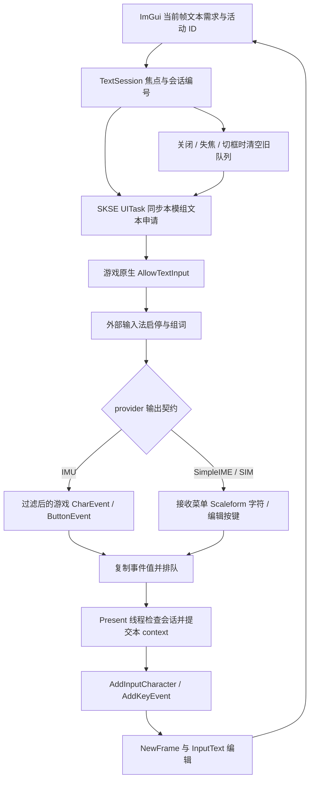
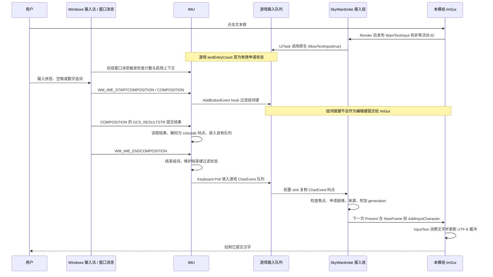
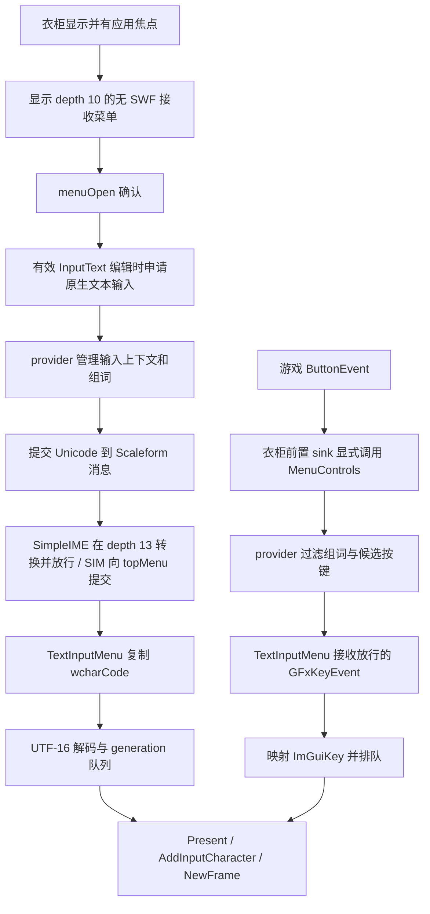

# ImGui 中文输入兼容完整报告：从外部输入法调研到 IMU 游戏内修复

日期：2026-10-05。案例项目：SkyWardrobe，C++23 / SKSE / CommonLibSSE-NG / Dear ImGui 1.92.7 / DX11。

**结果：外部输入法接入完成，Input Method Unlocked（IMU）在初版出现的问题经修正后，用户确认“问题得到了修复”。** 现场日志核对的环境为 Skyrim 1.5.97、Input Method Unlocked 2.1.0。候选窗口不可见此前被明确排除出本轮修复范围；用户此次总体确认没有逐项说明候选窗口表现，因此本报告不将候选窗显示或社区着色器因果关系写为已验证结论。SimpleIME 和 Skyrim Input Method 的接入已有实现和离线验证，本次游戏内成功反馈针对 IMU。

本报告记录信息搜集、初版设计、失败反馈、原因分析、最终实现和完整输入流程。代码片段来自报告日期的工作区；注明“节选”或“简化”的代码省略了日志、锁、异常路径等辅助部分，完整实现以链接的源码为准。

## 1. 问题是什么：中文显示与中文输入分属不同层

ImGui 中文兼容至少涉及四层：

| 层 | 需要解决的问题 | 本案例的责任方 |
| --- | --- | --- |
| 字形显示 | 字体是否包含目标汉字，字体纹理能否正确绘制 | SkyWardrobe 字体加载和 ImGui / DX11 |
| 文本编码 | 输入数据是 UTF-8 字节、UTF-16 单元还是 Unicode 码点 | 外部 provider 的输出契约与本模组解码 |
| 输入法组词 | 拼音、候选、确认、取消、输入法内退格 | Windows 输入法与外部输入法模组 |
| 编辑交互 | 文本焦点、提交文字、光标、已提交文字退格、菜单 Esc | SkyWardrobe 接入层与 ImGui |

加载中文字体只能解决第一层。调用 `io.AddKeyEvent()` 也不能把拼音键盘事件直接变成汉字。正确的接入必须让输入法完成组词，再把**已提交的 Unicode 文字**送到目标 ImGui context，同时让输入法优先消费组词操作键。

本案例 UI 绘制位于 DX11 Present hook，原有鼠标使用 Skyrim 相对移动事件维护虚拟指针。项目初始化了 ImGui Win32 backend，但没有把全部原始 Windows 按键、字符消息交给该 backend；因此不能套用“初始化 Win32 backend 后中文输入自然可用”的普通窗口假设。现有鼠标事件路径也不适合为了输入法整体替换成 Win32 绝对坐标路径。

## 2. 用户目标与实施边界

最初要求有两个方向：优先兼容已有输入法模组；若独立兼容 Windows 输入法很方便，可以作为备选。随后明确要求同时实现外部模组接入，**不完成独立 IMM 后备**。

实施覆盖 SimpleIME、Skyrim Input Method - Use System's IME、Input Method Unlocked 三个 provider。一个进程只选择一个已知 provider；同时检测到多个时显示冲突，不主动申请外部文本输入。没有 provider 时保留游戏文字和 ImGui 剪贴板功能。

SkyWardrobe 不接管外部输入法的 Windows 输入上下文、候选窗口或组词字符串。跨 DLL 的独立 ImGui context 也不会自动共享输入：外部模组向自己的 `ImGui::GetIO()` 提交文字，不等于文字会进入 SkyWardrobe，必须找到实际的跨模块输出事件。

## 3. 信息搜集与依据修正

### 3.1 先检查宿主的现有数据路径

本地检查定位到以下入口：

| 本地文件 | 核对内容 |
| --- | --- |
| [Overlay.cpp](../../src/ui/Overlay.cpp) | Present 帧顺序、游戏 input sink、WndProc、字体和菜单开关 |
| [Plugin.cpp](../../src/Plugin.cpp) | DataLoaded 初始化、新建和读档清理 |
| [ControlMap.cpp](../../extern/CommonLibSSE-NG/src/RE/C/ControlMap.cpp) | CommonLib `AllowTextInput` 实际实现 |
| [InputMethodState.h](../../src/ui/InputMethodState.h) | provider 策略、字符来源、编辑会话、UTF-16 解码 |

一个关键发现是：本地 CommonLib 的 `ControlMap::AllowTextInput` 直接增减 `textEntryCount`，并不转入游戏原生函数。因此，对于 hook 原生 `AllowTextInput` 的外部插件，调用同名 wrapper 可能改变了计数，却没有触发插件的启停逻辑。初版即采用作者指南给出的原生 relocation 入口；这项正确设计保留到了最终版本。

### 3.2 三个 provider 的契约不同

| provider | 焦点契约 | 已提交文字 | 组词按键过滤位置 | 最终接入 |
| --- | --- | --- | --- | --- |
| SimpleIME | 原生 `AllowTextInput` | 菜单 Scaleform 字符 | SimpleIME 菜单链 | 下层字符接收菜单 + 放行的 GFx 编辑按键 |
| Skyrim Input Method | 原生 `AllowTextInput` 与文本计数 | 向 topMenu 发送 Scaleform 字符 | 菜单消息转换 / 过滤路径 | 同一接收菜单 + 放行的 GFx 编辑按键 |
| Input Method Unlocked | WndProc 检查 `textEntryCount > 0` | 向游戏队列插入 `CharEvent` | 游戏 `AddButtonEvent` 入队前 | 直接消费过滤后的游戏文字和按键 |

SimpleIME 作者提供了针对独立 ImGui UI 的接入指南：发布文本焦点，接收 Scaleform 字符，再送给自己的 ImGui context。其菜单将自定义 `0x80000001` 字符事件转换为标准 `kCharEvent` 后放行。GFx caret 不能直接代表独立 ImGui 输入框的位置，因此作者要求候选定位改为 Follow Cursor / None。[作者接入指南](https://www.nexusmods.com/skyrimspecialedition/articles/11843)、[菜单源码](https://github.com/cyfewlp/SimpleIME/blob/main/src/menu/ImeMenu.cpp)

Skyrim Input Method 的 `SendUnicodeMessage` 构造 `GFxCharEvent` 和 `BSUIScaleformData`，将提交文字发给 topMenu；它不是游戏 `CharEvent` provider。后续取得 `CustomRE.h` 后修正了早期推测：虽然它定义了自己的 C++ 字符结构，该结构使用的仍是标准 `kCharEvent` 标签，`wcharCode` 位于偏移 4。[提交源码](https://github.com/Kerite/SkyrimInputMethod/blob/main/src/Utils.cpp)、[字符结构](https://github.com/Kerite/SkyrimInputMethod/blob/main/src/RE/CustomRE.h)

IMU 早期只取得作者发布说明，关键源码获取曾失败。后续成功核对 main 2.1.0，源码参考固定为 commit `ac8647021079067c90406f8c2d3c694457c900cb`。其提交结果排入自身码点队列，键盘 Poll 再填充游戏字符队列；组词期间在 `AddButtonEvent` 前阻止相关键盘事件，并处理结束组词的按键，避免确认键继续进入下游 UI。[字符处理](https://github.com/VanCZ1/Input-Method-Unlocked/blob/ac8647021079067c90406f8c2d3c694457c900cb/src/InputMethod.cpp)、[按键过滤](https://github.com/VanCZ1/Input-Method-Unlocked/blob/ac8647021079067c90406f8c2d3c694457c900cb/src/Input.cpp)、[hook](https://github.com/VanCZ1/Input-Method-Unlocked/blob/ac8647021079067c90406f8c2d3c694457c900cb/src/Hooks.cpp)

IMU 发布版 2.0 作者说明的一次五字符限制不能直接泛化到 2.1.0 main：后者通过自有队列分帧填充游戏有限容量的字符队列。现场日志确认安装版本号是 2.1.0，但版本号本身不证明安装二进制与该固定 commit 完全一致。[2.0 作者说明](https://www.nexusmods.com/skyrimspecialedition/mods/191339?tab=description)

### 3.3 ImGui 的每帧焦点数据

核对 ImGui 1.92.7 源码后确认：`NewFrame()` 重置当帧 `PlatformImeData`，活动可编辑 `InputText` 设置 `WantTextInput`，`EndFrame()` 在 IME 数据变化时调用平台回调，并更新下一帧文本需求。为避免只依赖上一帧 `io.WantTextInput`，本项目在 `Render()` 后读取当帧 `PlatformImeData.WantTextInput`；同时发布活动 ID，区分两个位置相同的输入框。[imgui.cpp](https://github.com/ocornut/imgui/blob/v1.92.7/imgui.cpp)、[imgui_widgets.cpp](https://github.com/ocornut/imgui/blob/v1.92.7/imgui_widgets.cpp)

原始调研中的推断、当时未取得的源码和后续更正保存在 [外部输入法调研](ime-external-research.md)。本报告以补齐后的证据和最终代码为准。

## 4. 初版实现：统一管理正确，但统一菜单路径过度

初版建立了集中接入模块，做到了 provider 自动检测、成对文本申请、事件队列、编辑会话编号、唯一字符来源、UTF-16 解码和退出清理。SimpleIME / SIM 接收 Scaleform 文字，IMU 接收游戏文字，这个文字来源区分是正确的。

问题出在它把**全部外部 provider 的按键和文本申请就绪条件**都绑定到了菜单桥。初版对应仓库提交 `7a776c7`，关键逻辑如下：

```cpp
// 初版：三个外部 provider 都要求接收菜单打开。
show = overlayVisible && applicationFocused && IsExternal(provider);
want = show && session.Active() && menuOpen.load();
```

菜单打开后，Overlay 的前置 sink 不再直接向 ImGui 提交游戏键盘按键，而是显式调用 `MenuControls::ProcessEvent()`，随后仍返回 `kStop`，阻止 PlayerControls 和后续重复分发。原始 WndProc 则把 Esc 交给这条菜单路径。

这个策略适合需要 Scaleform 输出的 provider，却让 IMU 的直接游戏按键额外依赖另一套消息转换。**初版只按 provider 区分了字符通道，没有同步区分按键过滤后的接收入口和焦点申请条件。**

初版通过了 Debug 编译和离线逻辑测试。测试能证明路由判断、会话失效和编码处理，不能证明空白 IMenu 能在真实游戏中完成全部输入分发，也不能证明 IMU 的 Windows 消息、游戏过滤和菜单桥组合有效。

## 5. 游戏内失败反馈与原因分析

### 5.1 用户反馈

安装 IMU 后，用户报告：候选窗口不可见；空格或数字选词没有中文上屏；Esc 总是无法退出衣柜；退格有时无响应；输入法持续启用、无法关闭。候选窗口不可见被要求暂不处理，社区着色器只是可能原因，没有验证。

### 5.2 可以确认的实现缺陷

| 缺陷 | 代码证据 | 修正 |
| --- | --- | --- |
| IMU 申请文本依赖菜单打开 | `want` 对所有外部 provider 都检查 `menuOpen` | IMU 编辑时独立申请，菜单条件只适用于 SimpleIME / SIM |
| IMU 放行的游戏编辑按键未直接送 ImGui | `menuInput` 为真时跳过游戏键盘记录，依赖 MenuControls | IMU 的游戏按键直接进入原有 ImGui 按键队列 |
| Esc 关闭依赖菜单桥 | WndProc 不消费，关闭逻辑等 GFx Esc | 使用 IMU 放行的游戏 Esc 判断编辑退出 / 菜单关闭 |
| 焦点判定没有拒绝零 ID | 原会话只检查 active 标志，允许 active=true、id=0 | `active = active && id != 0` |
| 隐藏 UI 未清除 ImGui 活动控件 | 关闭时只清按键和鼠标，旧编辑 ID 可能保留 | 在绘制线程调用 `ImGui::ClearActiveID()` |

### 5.3 为什么这些缺陷与症状相关

中文上屏需要两条链同时成立：输入法已因有效文本焦点启用；提交文字到达正在编辑的 ImGui context。把 IMU 焦点就绪与菜单打开绑定，增加了不属于其公开契约的门控。退格和 Esc 又必须从 IMU 过滤后的游戏按键取得；将它们改送菜单链，使“输入法过滤完毕”到“ImGui 执行编辑”的路径依赖额外转换。

输入法持续启用还涉及焦点生命周期：若 IME 请求标志残留但活动 ID 已是零，应视为编辑结束；隐藏后保留活动控件，则再次显示可能恢复旧编辑并重新申请输入法。最终修正同时关闭了这两条不期望的申请路径。

这些是源码可确认的结构缺陷及合理机制解释。**现场旧日志只有加载版本和安装 hook 等信息，没有逐个汉字、按键、申请计数的完整轨迹；本轮又同时修正多处，所以不能将每个用户症状归因到某一行代码并声称已单独证明。** 修复后的用户反馈验证了这一组改动在当前使用环境中奏效。

## 6. 最终架构：共享会话，按 provider 选择入口

- 移除 IMU 对 SkyWardrobe Text Input 菜单桥的依赖，改为直接接收
  已被 IMU 过滤的游戏字符与编辑按键，修复中文不上屏、退格与
  输入法退出异常（src/ui/InputMethod.cpp）
- 引入 NeedsMenuBridge / CanAcquireTextInput 判定，隐藏衣柜时清除
  ImGui 活动控件并拒绝零 ID 文本焦点，避免重新打开时误启用输入法
- IMU 关闭判断改用游戏按键首次按下，长按 Esc 退出编辑后不再顺带
  关闭衣柜（src/ui/InputMethod.cpp）
- 新增 IME text lease acquired/released 与 IMU character arrived
  诊断日志并立即 flush，便于区分字符是否在有效编辑与申请状态下到达




统一的是焦点、生命周期、字符接收策略、线程交接；分开的是真正的文字和按键入口。IMU 不注册、不打开文本菜单桥，也不转交 MenuControls。SimpleIME / SIM 保留菜单桥，其候选窗和组词仍归 provider 管理。

## 7. 关键实现代码

### 7.1 区分菜单需求与文本申请条件

来源：[InputMethodState.h](../../src/ui/InputMethodState.h)。

```cpp
constexpr bool NeedsMenuBridge(Provider provider)
{
    // IMU 已在游戏事件入队前过滤组词按键，不需要再经过 Scaleform 菜单。
    return provider == Provider::kSimpleIME || provider == Provider::kSkyrimInputMethod;
}

constexpr bool CanAcquireTextInput(Provider provider, bool visible,
    bool focused, bool editing, bool menuOpen)
{
    return IsExternal(provider) && visible && focused && editing &&
        (!NeedsMenuBridge(provider) || menuOpen);
}
```

在 `SyncGameState()` 中，`show` 只对菜单型 provider 为真，`want` 使用上述策略。菜单可见不等于文本编辑激活；IMU 不需要菜单，但仍必须满足界面可见、应用有焦点、有效文本编辑三个条件。

### 7.2 通过原生入口成对申请，不每帧累加

来源：[InputMethod.cpp](../../src/ui/InputMethod.cpp)，以下为节选。

```cpp
void NativeAllowTextInput(bool allow)
{
    if (auto* controls = RE::ControlMap::GetSingleton())
    {
        // 进入可被输入法模组 hook 的游戏原生函数。
        using Function = void(RE::ControlMap*, bool);
        static REL::Relocation<Function> function{ RELOCATION_ID(67252, 68552) };
        function(controls, allow);
    }
}

// SyncGameState：按边界释放 / 申请，省略菜单请求和日志。
if (ownsTextInput && (!want || leaseID != id))
{
    NativeAllowTextInput(false);
    ownsTextInput = false;
    leaseID = 0;
}
if (want && !ownsTextInput && RE::ControlMap::GetSingleton())
{
    NativeAllowTextInput(true);
    ownsTextInput = true;
    leaseID = id;
}
```

`ownsTextInput` 只代表本模组持有的一份申请，不能把整个游戏的计数设为零。重复绘制同一输入框不会再次申请；切框先释放旧申请再申请新 ID。原生调用安排在 SKSE UITask，调用时不持有字符队列锁。

### 7.3 当前帧焦点与会话有效性

来源：[Overlay.cpp](../../src/ui/Overlay.cpp)、[InputMethodState.h](../../src/ui/InputMethodState.h)。

```cpp
// Render 后同步当帧编辑状态，避免只依赖平台回调的变化触发。
Overlay::InputMethod::PublishTextFocus(
    visible && !waitingForKey &&
        ImGui::GetCurrentContext()->PlatformImeData.WantTextInput,
    ImGui::GetActiveID());

// TextSession::SetFocus
bool SetFocus(bool active, std::uint32_t id)
{
    active = active && id != 0;
    id = active ? id : 0;
    if (active_ == active && id_ == id) return false;
    active_ = active;
    id_ = id;
    ++generation_;
    return true;
}
```

平台 IME 回调被替换为只调用 `PublishTextFocus()`，不调用本模组的独立 IMM 处理。帧尾同步还覆盖活动 ID 变化但 IME 位置数据没变化的情况。会话边界会清空队列、重置 UTF-16 半个代理对、标记按键状态待清理；排队事件带 generation，提交前再次检查。

### 7.4 IMU 的游戏事件直接接入

来源：[Overlay.cpp](../../src/ui/Overlay.cpp)，以下为前置 sink 的节选。

```cpp
const bool menuInput = Overlay::InputMethod::UsesMenuInput();

// 游戏键盘 ButtonEvent 分支：IMU 下 menuInput 为 false。
const auto virtualKey = ScanCodeToVirtualKey(code);
if (virtualKey && !menuInput)
    inputRecords.push_back({ InputRecord::Kind::kKey,
        virtualKey, down, 0, 0, button->IsDown() });

// 游戏 CharEvent 分支。
Overlay::InputMethod::QueueGameCharacter(character->keyCode);

// 只有菜单型 provider 才转交 MenuControls；实际调用在 inputMutex 外。
if (menuInput)
    if (auto* menus = RE::MenuControls::GetSingleton())
        menus->ProcessEvent(events, source);
return RE::BSEventNotifyControl::kStop;
```

该 sink 被 `PrependEventSink` 放到游戏输入分发前部。它不绕过 IMU 的组词过滤，因为 IMU 的过滤发生在游戏事件创建前。衣柜可见时返回 `kStop`，避免放行的编辑键又触发玩家动作。鼠标继续使用原相对位移和虚拟指针。

### 7.5 一个字符只有一个有效来源

来源：[InputMethodState.h](../../src/ui/InputMethodState.h)。

```cpp
constexpr bool AcceptsSource(Provider provider, CharacterSource source)
{
    // 不能按字符值去重，否则连续相同汉字会被吞掉。
    if (provider == Provider::kSimpleIME || provider == Provider::kSkyrimInputMethod)
        return source == CharacterSource::kScaleform;
    return source == CharacterSource::kGame;
}
```

菜单字符的数据立即复制，不持有外部事件指针：在已核对的 provider 布局中，`GFxEvent` 为 4 字节，下一字段为 `wcharCode`，代码用 `memcpy` 读取该值。SimpleIME 自定义标签由它自己的上层菜单转换，接入层接收标准字符事件，不接管其对象释放。

菜单路径的 UTF-16 单元经过 `Utf16Decoder` 合成码点；游戏 IMU 路径已经是 Unicode 码点，不把它当 ANSI 字节再次转换。代理对公式为 `0x10000 + ((high - 0xD800) << 10) + low - 0xDC00`。异常代理对或非法码点使用 U+FFFD，切框时重置未完成的代理对。

### 7.6 在目标 context 所在线程提交文字

来源：[InputMethod.cpp](../../src/ui/InputMethod.cpp)，以下为 `Flush()` 节选。

```cpp
// 加锁交换 pending，并取得当前 generation / active 后，在绘制线程提交。
auto& io = ImGui::GetIO();
if (clear) io.ClearInputKeys();
for (const auto& event : pending)
{
    if (event.generation != generation) continue;
    if (event.kind == Event::Kind::kCharacter)
    {
        if (active && event.code != 0) io.AddInputCharacter(event.code);
    }
    // 省略菜单编辑键映射和剪贴板回退。
}
```

游戏回调只排队，Present 线程访问 SkyWardrobe 自己的 ImGui context。`Flush()` 和游戏按键 `FlushInputRecords()` 位于 `ImGui::NewFrame()` 之前，因此当帧控件可以消费文字和按键。

### 7.7 Esc 和隐藏清理

来源：[Overlay.cpp](../../src/ui/Overlay.cpp)，以下为节选。

```cpp
// 使用 IMU 过滤后到达的首次按下；组词 Esc 不会绕过 provider。
else if (record.code == VK_ESCAPE && record.initialPress &&
    Overlay::InputMethod::UsesGameInputMethod() &&
    !Overlay::InputMethod::WantsTextInput())
{
    Overlay::CloseAllMenus();
}
else if (const auto key = VirtualKeyToImGuiKey(record.code); key != ImGuiKey_None)
{
    io.AddKeyEvent(key, record.down);
}

// SetOverlayVisible(false) 的清理片段，执行于绘制线程。
ImGui::ClearActiveID();
ImGui::GetIO().ClearInputKeys();
ImGui::GetIO().ClearInputMouse();
```

外部输入法模式下，WndProc 不抢先根据原始 `WM_KEYDOWN / VK_ESCAPE` 关闭衣柜。IMU 放行的 Esc 在编辑状态下送 ImGui；无文本编辑时才关闭衣柜。`initialPress` 来自 `ButtonEvent::IsDown()`，防止同一次长按在下一帧继续关闭 UI。

原窗口 Unicode 属性通过 `IsWindowUnicode()` 保留，安装和调用旧 WndProc 分别匹配 `SetWindowLongPtrA/W`、`CallWindowProcA/W`。本模组不再接收第二份 `WM_CHAR / WM_IME_COMPOSITION` 文字，也不改变 IMU 自身的 ANSI 消息转换契约。

## 8. 完整输入流程

### 8.1 IMU：从点击文本框到中文上屏



IMU 的英文 / 普通字符路径由其 WndProc 处理 `WM_CHAR`，按窗口代码页得到 Unicode 后排入同一 provider 队列。SkyWardrobe 的接收端不区分“来自英文按键还是中文确认”，只消费最终游戏码点。

一次结果串长于游戏字符队列容量时，所核对的 IMU 2.1.0 源码保留剩余码点，在后续 Poll 继续发送。游戏事件到达后，衣柜复制值，不保留 `CharEvent*`。

### 8.2 退格的两层行为

| 当前状态 | 按键路径 | 应有结果 |
| --- | --- | --- |
| 正在组词 | Windows 输入法处理；IMU 阻止游戏 ButtonEvent 下发 | 删除拼音 / 输入法中的未提交内容 |
| 组词结束或没有组词，文本框仍在编辑 | IMU 放行游戏 ButtonEvent → 衣柜按键队列 → `AddKeyEvent(Backspace)` | ImGui 删除输入框中已提交文字 |
| 文本框未编辑 | 不持有本模组文本申请 | 不删除旧输入框内容 |

组词结束的那次按键还可能受到 provider 的结束键保护，避免同一操作既改变输入法又改变控件。退格“先删组词，再删已提交文字”的边界依赖 provider 的真实过滤状态，不应在 UI 里猜测拼音长度或自行删除第二次。

### 8.3 Esc、结束编辑与重开

组词中的 Esc 先由输入法取消并被 IMU 过滤；之后放行的 Esc 交给 ImGui 退出编辑；再一次首次按下的 Esc 触发衣柜关闭。结束编辑导致帧尾发布 false / 零 ID，UITask 释放本模组申请。关闭衣柜还清除 ImGui 活动控件、IO 状态和待处理输入，再开时等待新的点击激活。

应用失焦、新建 / 读档、其他原生菜单接管也会使会话失效并请求释放申请。前台窗口检查进程身份，容许 SimpleIME 的同进程输入窗口获得焦点。菜单型 provider 在失焦隐藏接收菜单的现有路径可能同时关闭衣柜，不应把其行为描述为保证面板始终保持打开。

### 8.4 SimpleIME / SIM 的完整分支



菜单桥使用 `kCustomRendering`、`kUsesMenuContext`、`kAllowSaving`、`kDisablePauseMenu`，不加载 SWF、不暂停、不接管游戏指针。处理消息后返回 `kHandled`，防止字符继续影响下层原生菜单。这个分支有实现依据与编译结果，本次 IMU 成功反馈不等于它们已完成游戏验收。

### 8.5 剪贴板与重复输入

IMU / 无 provider 使用 ImGui 的 Ctrl+V。SimpleIME / SIM 可能自行发送 Unicode 粘贴，因此桥抑制对应的重复 Ctrl+V 编辑快捷键；provider 关闭自身 Unicode 粘贴时，已核对的回退字符触发 ImGui 剪贴板粘贴。SimpleIME 的回退为 Ctrl 状态下的 `v / V / 0x16`，SIM 为 `0x16`，这一策略依赖其当前输出契约。

文字不按值或时间窗口去重。“裙裙”是两个合法提交；正确方法是选择唯一有效来源，而不是删除相同码点。也不能同时从 Windows 字符、游戏字符和 Scaleform 字符三个入口向同一 ImGui context 提交同一结果。

## 9. 线程、对象所有权与清理边界

| 工作 | 执行位置 | 约束 |
| --- | --- | --- |
| Windows 输入法消息、上下文、候选窗 | 外部 provider 的窗口处理 | 衣柜保持旧 WndProc 链，不另建 IMM 后备 |
| 游戏事件 / 菜单消息接收 | 相应游戏回调 | 只复制数据，队列加锁，不调用本 ImGui 编辑状态 |
| 原生申请、释放、菜单显示请求 | SKSE UITask | 不持有字符队列锁调用引擎；只释放自己的申请 |
| 字符 / 按键提交、活动 ID 清理 | DX11 Present 绘制线程 | 使用本 context，NewFrame 前提交 IO |

generation 只保证本接入层已排队的旧事件不会在切框后消费。外部 provider 延迟发送的无会话标签事件，若在新焦点建立后才到达，接入层无法仅凭码点知道它属于旧组词。因此报告不宣称会话编号能清除所有外部延迟事件。切框时释放 / 申请为 provider 提供边界，但 IMU 通过后续窗口消息观察计数，短暂的释放再申请不等于已证明其一定观察到零并取消旧组词。

这些边界不影响用户已确认的本次修复结果，但决定其他工程复用时需要验证的内容。

## 10. 验证与诊断证据

| 阶段 | 证据 | 能支持的结论 |
| --- | --- | --- |
| 初版 | Debug 构建与离线逻辑测试通过 | 代码可构建，纯逻辑判断符合当时设计 |
| 失败反馈 | 用户列出不上屏、Esc、退格、启停异常 | 初版在实际 IMU 环境中不可用 |
| 环境核对 | 日志显示 Skyrim 1.5.97 / IMU 2.1.0 与 hook 安装 | provider 已加载，失败不能简单解释为未安装 |
| 最终修改 | 提权 `scripts/Build-Debug.ps1` 成功；输入测试通过；`git diff --check` 通过 | 最终代码与新增路由 / 焦点回归检查通过 |
| 游戏复测 | 2026-10-05 用户明确回复“问题得到了修复” | 当前 IMU 使用环境中的报告问题已获得成功反馈 |

构建按仓库指定脚本执行，没有另改 toolchain，没有进行部署或 SHA-256 检查。此次报告编写不修改 C++；这里记录此前完成的构建与测试。

[InputMethodTests.cpp](../../tests/InputMethodTests.cpp) 覆盖 provider 选择与冲突、菜单需求、IMU 不等待菜单、非编辑 / 隐藏 / 失焦不申请、零 ID 拒绝与释放、同一输入框不重复申请、旧 generation 失效、来源唯一、粘贴策略、重复汉字、UTF-16 代理对和异常码点。它没有模拟 Windows IME、DirectInput hook 或游戏菜单分发。

最终添加的诊断日志如下，示例仅展示字段形式，不是假造运行输出：

```text
External IME provider: <provider>
IME text lease acquired: provider=<name>, editor=<id>, count=<n>
IME text lease released: provider=<name>, editor=<id>, count=<n>
IMU character arrived: editing=<bool>, editor=<id>, visible=<bool>, focused=<bool>, leaseReady=<bool>
```

provider 和申请边界日志即时刷新；非 ASCII 到达记录每个编辑会话最多一次，不记录字符内容。“到达”表示接收入口被调用，随后是否被接受仍由焦点和申请条件决定。释放后的 count 非零可能是其他菜单的申请，不能据此强行清零。当前成功反馈没有附带逐事件复测日志，因此无需虚构汉字轨迹或详细输入法品牌、窗口模式等未记录环境信息。

## 11. 可迁移到其他 ImGui 工程的方案

可以把接入拆成四个接口，而让宿主分别实现它们：

```cpp
// 通用接口示意，不是本仓库新增 API。
PublishTextFocus(editing, editorID);        // ImGui -> 宿主焦点机制
QueueCommittedText(codePoint, session);    // provider -> 接入队列
QueueFilteredKey(key, down, modifiers);    // provider 过滤后 -> 编辑队列
EndTextSession();                          // 关闭、失焦、切框等生命周期边界
```

迁移时按这个顺序检查：

1. 确认字体和字符编码，再独立验证已提交文字能够显示。
2. 找到宿主真正的文本焦点入口，检查 wrapper 是否绕过 provider hook。
3. 核对 provider 输出的编码、事件来源和组词按键过滤位置。
4. 在过滤后的入口接收编辑按键；让 Windows / provider 优先处理候选、确认、取消和组词退格。
5. 在目标 ImGui context 的线程、NewFrame 前提交 IO；异步回调只排队。
6. 成对管理文本申请，按活动 editorID 划定会话，关闭时结束编辑。
7. 保留宿主窗口消息链，选择唯一文字来源，避免两套输入法后端同时接管同一窗口。
8. 用真实输入法检查空格 / 数字选词、退格两层行为、中英文切换、Esc 分层退出和重新打开。

**通用结论是：ImGui 中文输入兼容需要“有效文本焦点 + 输入法已提交 Unicode + 过滤后的编辑按键 + 成对生命周期清理”。** 本案例证明，在已有 provider 的宿主中可以通过这些边界完成接入，无需重新实现输入法。

Skyrim relocation ID、SKSE UITask、游戏 `CharEvent`、Scaleform 菜单 depth 和 `textEntryCount` 属于本宿主的适配细节；其他工程应替换为自己的 API。普通 Win32 应用可以使用官方 backend 的对应文字消息路径，但仍须保证输入上下文和消息真正到达；本次没有实现或验证独立 IMM / TSF，因此不把本报告当作任意 Windows 输入法的完整原生后端教程。

## 12. 文件索引

| 内容 | 位置 |
| --- | --- |
| 当前完整报告 | 本文件 |
| 最初方案与备选讨论 | [InputMethodCompatibility.md](../InputMethodCompatibility.md) |
| 信息搜集与阶段性证据 | [ime-external-research.md](ime-external-research.md) |
| 当前接入行为 | [InputMethodIntegration.md](../InputMethodIntegration.md) |
| 游戏验收项目 | [RuntimeChecks.md](../RuntimeChecks.md) |
| 接入模块 | [InputMethod.cpp](../../src/ui/InputMethod.cpp)、[InputMethod.h](../../src/ui/InputMethod.h) |
| 可离线测试的策略与状态 | [InputMethodState.h](../../src/ui/InputMethodState.h) |
| 游戏事件、帧顺序与窗口链 | [Overlay.cpp](../../src/ui/Overlay.cpp) |
| 回归测试 | [InputMethodTests.cpp](../../tests/InputMethodTests.cpp) |
